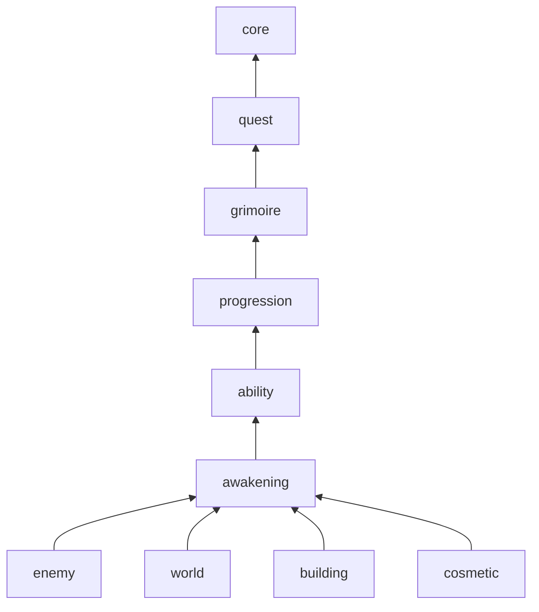
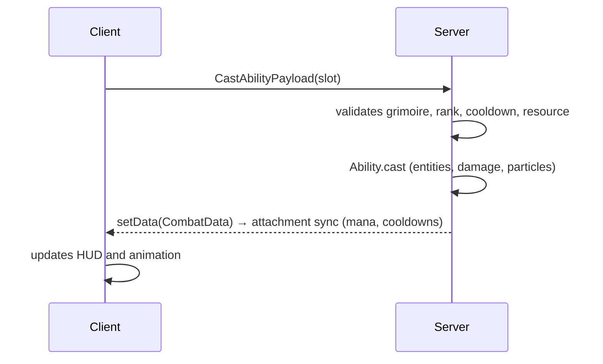

# Architecture

How the mod's code is organized. Game rules live in the [design document](https://claude.ai/artifact/TrcT8PC62YBtGZVcwWHpJx); decisions in [`adr/`](adr/).

## Principles
- **Server rules:** state and rules run on the server. The client only sends intent (a key press) and draws (HUD, grimoire, particles).
- **Pure rules:** game formulas and decisions live in classes with no Minecraft import, tested with JUnit. Everything else only turns events into calls and results into the world.
- **One feature, one package:** everything for a design system lives together.
- **One-way dependencies:** a higher feature calls a lower one directly; the lower one tells the higher one through its own event. No cycles.
- **NeoForge events and data attachments**; mixins only when there is no event.
- **Balancing in config**, never in constants: values "to be tuned in testing" live in the server TOML.

## Packages
Feature first, then technical type. A subpackage exists only if it has a class.

```
com.navesdev.grimoireknights
├─ GrimoireKnights            common entry point: calls the modules in order
├─ GrimoireKnightsClient      client entry point: calls the client modules
├─ core/                      general, no game rules
├─ grimoire/
│  ├─ GrimoireModule          registers everything in the feature
│  ├─ rules/                  plain Java (ElementLottery, ...)
│  ├─ attachment/             player data
│  ├─ event/                  listens to game events, calls rules
│  ├─ network/                payloads and handlers
│  ├─ config/                 the feature's ModConfigSpec
│  ├─ block/ item/ entity/    registered content
│  ├─ command/                test commands
│  ├─ gametest/               GameTests
│  └─ client/                 client only: rendering, HUD, keys
└─ ...                        other features, same layout
```

## Features
From the bottom up; each one depends only on those above it in the list.

- **core:** network registration (`RegisterPayloadHandlersEvent`), own registries, creative tab (`CoreTabs.MAIN`; each feature adds its own items), utilities, VFX runtime (`core/vfx`, `core/client/vfx`; see `docs/vfx.md`). Knows no feature.
- **quest:** generic quest engine (see [Quests](#quests)). Knows no specific quest.
- **grimoire:** element, clover leaves, weighted lottery, calling, ceremony (priest and Grimoire Altar), grimoire swap, floating grimoire. The Altar lives here because the ceremony depends on it; `building` uses the same block later.
- **progression:** XP, level, stats, tree, ranks, anti-magic mastery.
- **ability:** spells and swords on the Z/X/C keys, mana and anti-mana, cooldowns, PvP.
- **awakening:** awakening bar, stages, surpassing limits.
- **enemy:** Order mages, demons, mythical creatures, bosses.
- **world:** structures, starter village, safe zone, underworld.
- **building:** core block, buildings, themed blocks.
- **cosmetic:** mantle, crest, aura.



Examples of the one-way rule:
- Swapping grimoires refunds tree points: `grimoire` fires `GrimoireChangedEvent`, `progression` listens and refunds.
- Blocking a spell grants mastery: `ability` calls `progression` directly.
- A full calling points at the tower: `grimoire` fires `GrimoireCalledEvent`, `world` listens and draws the particles to the nearest Grimoire Tower.
- A cast spell turns a page of the floating grimoire: `ability` calls `grimoire` directly.
- A defeated boss promotes: `enemy` calls `progression` directly.

## Modules
Each feature has a `<Name>Module` with `register(IEventBus)`: it creates its `DeferredRegister`s, attachments, configs, payloads and listeners. Client code lives in `client/`, with a `<Name>ClientModule` called only by `GrimoireKnightsClient`; common code never imports `client/`.

## Abilities
- `Ability`: single interface for spells and swords (cost, cooldown, `cast`). One class per ability (`Fireball`, `Greatsword`).
- `Element`: the grimoire's element; defines the 3 abilities, the resource (mana or anti-mana) and the awakening.
- Both in their own registries (`grimoireknights:ability`, `grimoireknights:element`), with `sync(true)` so only the id goes over the network. Each feature owns its registry key and creates it with `core.registry.CoreRegistries`; `core` doesn't know the types.
- `Element` holds abilities by id (`ResourceLocation`), not by object: `grimoire` sits below `ability` and doesn't import `Ability`.
- Ability classes in `ability/spell/` (spells) and, later, `ability/sword/` (swords).
- New element = register entries; the lottery and HUD don't change.
- HUD (only with a grimoire): upright mana bar left of the hotbar, past the offhand slot, with the Z slot below it; the slot icon is `textures/gui/ability/<ability>.png` and darkens bottom to top during the cooldown. Element icons in `textures/gui/element/<element>.png`. Icons generated by `art/icons/run.py`. Free choice at the ceremony: a screen with one card per registered element (large icon and name); clicking chooses, closing postpones (talk to the priest again).

## Quests
A single engine for every task: story (forgotten grimoire, demon quests), quest board, whatever comes next. A special quest is a regular quest with more behavior hooked on its events.

- **Quest** (`Quest`): JSON in the `grimoireknights:quest` datapack registry; since the key isn't vanilla, NeoForge prefixes the namespace and the file lives at `data/<namespace>/grimoireknights/quest/<id>.json`. Fields: objectives, rewards, prerequisites, whether it repeats, where it shows up (story, board).
- **Objective** (`ObjectiveType`) and **reward** (`RewardType`): one class per type, in their own registries. `quest` brings the generic ones (kill entity by tag, go to a place, hand in an item; give XP, give an item). Each feature registers its own in its module: `grimoire` registers the `grant_grimoire` reward, `progression` registers `unlock_mastery`.
- **Progress** in the player's `QuestData`; the engine updates objectives and pays rewards on the server.
- **Special behavior:** the engine fires `QuestStartedEvent`, `QuestFailedEvent` and `QuestCompletedEvent` with the quest id. The owning feature listens and acts: in the forgotten grimoire quest, `enemy` makes the mage attack the village and shows the grimoire below 25% health.
- New regular quest = JSON only. New objective or reward type = one class.

## Player data
Data attachments on the player, serializable and kept on death. Each feature owns its own:

| Attachment | Feature | Holds |
|---|---|---|
| `GrimoireData` | grimoire | element, leaves, ceremony done, grimoire calling |
| `ProgressData` | progression | XP, level, stats, tree, rank, mastery |
| `CombatData` | ability | mana/anti-mana, cooldowns; Mana stat until `ProgressData` exists (stage 2) |
| `AwakeningData` | awakening | bar, stage, limit surpassed |
| `QuestData` | quest | active quests (progress of each objective) and completed ones |

Data are immutable records: change them with `setData`, never by mutating the object. NeoForge 21.1.265 syncs attachments on its own (`AttachmentType.Builder.sync`): it sends everything on joining the world and again on every `setData`. Each attachment picks who receives it: `GrimoireData` goes to everyone who can see the player (they draw their floating grimoire); `CombatData` and `QuestData` only to the owner. The client reads from the same attachment.

## Flow of a spell


## Pure rules and config
- `rules/` takes values, returns a result; it reads neither config nor world. E.g. `ElementLottery.draw(weights, random)`.
- Each feature's `config/` is a `SERVER` `ModConfigSpec` (synced to the client), file `grimoireknights-<feature>-server.toml`. `event/` reads the config and passes the values to `rules/`.
- Config validated on load (ranges in the `ModConfigSpec`); an invalid value fails early with a clear message.

## Errors
- Invalid client payload (no grimoire, locked slot, no resource): ignore it and log at debug. When in doubt, deny.
- An exception from `rules/` bubbles up as a programming error; it isn't handled silently.

## Tests
- `rules/`: JUnit in `src/test`, mirroring the package.
- Integration (attachment, event, entity): GameTest in the feature's `gametest/`, run by `./gradlew runGameTestServer`.
- In game: `./gradlew runClient`, with each feature's test commands.

## Resources
- Texts in `assets/grimoireknights/lang/`.
- Textures, models and animations grouped by feature inside the type: `textures/entity/enemy/`, `geo/ability/`.
- `.nbt` structures generated by script (`art/structures/run.py`, see [`structures.md`](structures.md)) and worldgen JSON in `data/grimoireknights/`, owned by `world`.
