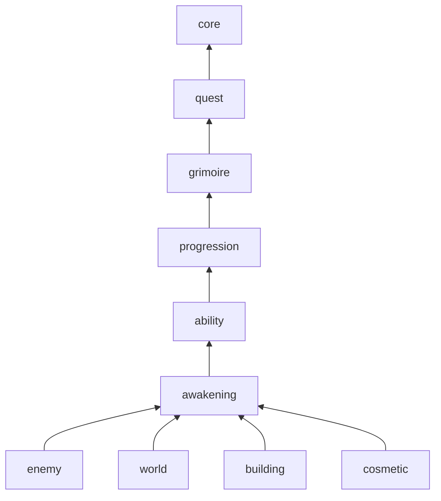
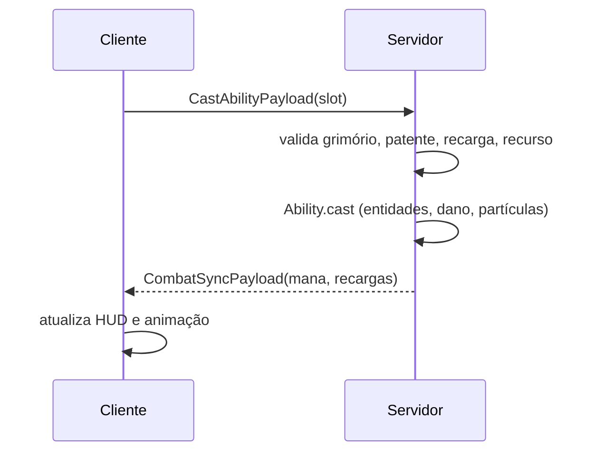

# Arquitetura

Como o código do mod se organiza. Regras do jogo ficam no [documento de design](https://claude.ai/artifact/TrcT8PC62YBtGZVcwWHpJx); decisões em [`adr/`](adr/).

## Princípios
- **Servidor manda:** estado e regras rodam no servidor. O cliente só envia intenção (tecla apertada) e desenha (HUD, grimório, partículas).
- **Regra pura:** fórmulas e decisões do jogo ficam em classes sem import de Minecraft, testadas com JUnit. O resto só traduz evento em chamada e resultado em mundo.
- **Uma funcionalidade, um pacote:** tudo de um sistema do design mora junto.
- **Dependência num sentido só:** funcionalidade de cima chama a de baixo direto; a de baixo avisa a de cima por evento próprio. Sem ciclos.
- **Eventos e data attachments** do NeoForge; mixin só quando não houver evento.
- **Balanceamento em config**, nunca em constante: valores "a ajustar nos testes" ficam no TOML do servidor.

## Pacotes
Primeiro a funcionalidade, depois o tipo técnico. Só existe o subpacote que tiver classe.

```
com.navesdev.grimoireknights
├─ GrimoireKnights            entrada comum: chama os módulos em ordem
├─ GrimoireKnightsClient      entrada do cliente: chama os módulos de cliente
├─ core/                      geral, sem regra de jogo
├─ grimoire/
│  ├─ GrimoireModule          registra tudo da funcionalidade
│  ├─ rules/                  Java puro (ElementLottery, ...)
│  ├─ attachment/             dados do jogador
│  ├─ event/                  ouve eventos do jogo, chama rules
│  ├─ network/                payloads e handlers
│  ├─ config/                 ModConfigSpec da funcionalidade
│  ├─ block/ item/ entity/    conteúdo registrado
│  ├─ command/                comandos de teste
│  ├─ gametest/               GameTests
│  └─ client/                 só cliente: render, HUD, teclas
└─ ...                        demais funcionalidades, mesmo formato
```

## Funcionalidades
Da base para o topo; cada uma só depende das que estão acima dela na lista.

- **core:** registro da rede (`RegisterPayloadHandlersEvent`), registros próprios, utilitários. Não conhece nenhuma funcionalidade.
- **quest:** motor genérico de missões (ver [Missões](#missões)). Não conhece nenhuma missão específica.
- **grimoire:** elemento, folhas do trevo, sorteio por pesos, chamado, cerimônia (sacerdote e Altar do Grimório), troca de grimório, grimório flutuante. O Altar mora aqui porque a cerimônia depende dele; `building` usa o mesmo bloco depois.
- **progression:** XP, nível, status, árvore, patentes, maestria do anti-magia.
- **ability:** magias e espadas nas teclas Z/X/C, mana e antimana, recarga, PvP.
- **awakening:** barra de despertar, estágios, superar limites.
- **enemy:** magos da Ordem, demônios, criaturas míticas, bosses.
- **world:** estruturas, vilarejo inicial, zona segura, submundo.
- **building:** bloco central, construções, blocos temáticos.
- **cosmetic:** manto, brasão, aura.



Exemplos do sentido único:
- Trocar de grimório devolve os pontos da árvore: `grimoire` dispara `GrimoireChangedEvent`, `progression` ouve e devolve.
- Bloquear magia dá maestria: `ability` chama `progression` direto.
- Chamado cheio aponta a torre: `grimoire` dispara `GrimoireCalledEvent`, `world` ouve e desenha as partículas até a Torre dos Grimórios mais perto.
- Magia lançada vira página do grimório flutuante: `ability` chama `grimoire` direto.
- Boss derrotado promove: `enemy` chama `progression` direto.

## Módulos
Cada funcionalidade tem um `<Nome>Module` com `register(IEventBus)`: cria seus `DeferredRegister`, attachments, configs, payloads e listeners. Código de cliente fica em `client/`, com `<Nome>ClientModule` chamado só por `GrimoireKnightsClient`; código comum nunca importa `client/`.

## Habilidades
- `Ability`: interface única para magias e espadas (custo, recarga, `cast`). Uma classe por habilidade (`Fireball`, `Greatsword`).
- `Element`: elemento do grimório; define as 3 habilidades, o recurso (mana ou antimana) e o despertar.
- Os dois em registros próprios (`grimoireknights:ability`, `grimoireknights:element`), com `sync(true)` para mandar só o id pela rede. Cada funcionalidade é dona da chave do seu registro e o cria com `core.registry.CoreRegistries`; `core` não conhece os tipos.
- `Element` guarda as habilidades por id (`ResourceLocation`), não por objeto: `grimoire` fica abaixo de `ability` e não importa `Ability`.
- Classes de habilidade em `ability/spell/` (magias) e, depois, `ability/sword/` (espadas).
- Novo elemento = registrar entradas; sorteio e HUD não mudam.

## Missões
Um motor só para toda tarefa: história (grimório esquecido, quests do demônio), quadro de missões, o que vier depois. Missão especial é missão comum com mais comportamento pendurado nos eventos dela.

- **Missão** (`Quest`): JSON de registro de datapack `grimoireknights:quest`; como a chave não é do vanilla, o NeoForge prefixa o namespace e o arquivo fica em `data/<namespace>/grimoireknights/quest/<id>.json`. Campos: objetivos, recompensas, pré-requisitos, se repete, onde aparece (história, quadro).
- **Objetivo** (`ObjectiveType`) e **recompensa** (`RewardType`): uma classe por tipo, em registros próprios. O `quest` traz os genéricos (matar entidade por tag, ir a um lugar, entregar item; dar XP, dar item). Cada funcionalidade registra os seus no próprio módulo: `grimoire` registra a recompensa `grant_grimoire`, `progression` registra `unlock_mastery`.
- **Progresso** no `QuestData` do jogador; o motor atualiza objetivos e paga recompensas no servidor.
- **Comportamento especial:** o motor dispara `QuestStartedEvent`, `QuestFailedEvent` e `QuestCompletedEvent` com o id da missão. A funcionalidade dona ouve e age: na missão do grimório esquecido, `enemy` faz o mago atacar o vilarejo e mostra o grimório abaixo de 25% de vida.
- Nova missão comum = só JSON. Novo tipo de objetivo ou recompensa = uma classe.

## Dados do jogador
Data attachments no jogador, serializáveis e mantidos na morte. Cada funcionalidade é dona dos seus:

| Attachment | Funcionalidade | Guarda |
|---|---|---|
| `GrimoireData` | grimoire | elemento, folhas, cerimônia feita, chamado do grimório |
| `ProgressData` | progression | XP, nível, status, árvore, patente, maestria |
| `CombatData` | ability | mana/antimana, recargas; status Mana até existir o `ProgressData` (etapa 2) |
| `AwakeningData` | awakening | barra, estágio, limite superado |
| `QuestData` | quest | missões ativas (progresso de cada objetivo) e concluídas |

Dados são records imutáveis: muda com `setData`, nunca mexendo no objeto. O NeoForge 21.1.265 sincroniza attachment sozinho (`AttachmentType.Builder.sync`): manda tudo ao entrar no mundo e de novo a cada `setData`. Cada attachment escolhe quem recebe: `GrimoireData` vai para todos que veem o jogador (desenham o grimório flutuante dele); `CombatData` e `QuestData` só para o dono. O cliente lê do mesmo attachment.

## Fluxo de uma magia


## Regras puras e config
- `rules/` recebe valores, devolve resultado; não lê config nem mundo. Ex.: `ElementLottery.draw(weights, random)`.
- `config/` de cada funcionalidade é um `ModConfigSpec` tipo `SERVER` (sincronizado com o cliente), arquivo `grimoireknights-<funcionalidade>-server.toml`. O `event/` lê a config e passa os valores para `rules/`.
- Config validada no carregamento (faixas no `ModConfigSpec`); valor inválido quebra cedo com mensagem clara.

## Erros
- Payload do cliente inválido (sem grimório, slot bloqueado, sem recurso): ignora e registra no log em debug. Na dúvida, nega.
- Exceção de `rules/` sobe como erro de programação; não se trata em silêncio.

## Testes
- `rules/`: JUnit em `src/test`, espelhando o pacote.
- Integração (attachment, evento, entidade): GameTest em `gametest/` da funcionalidade, rodado por `./gradlew runGameTestServer`.
- No jogo: `./gradlew runClient`, com os comandos de teste de cada funcionalidade.

## Recursos
- Textos em `assets/grimoireknights/lang/`.
- Texturas, modelos e animações agrupados por funcionalidade dentro do tipo: `textures/entity/enemy/`, `geo/ability/`.
- Estruturas `.nbt` geradas por script (`art/structures/run.py`, ver [`estruturas.md`](estruturas.md)) e JSON de worldgen em `data/grimoireknights/`, donos: `world`.
